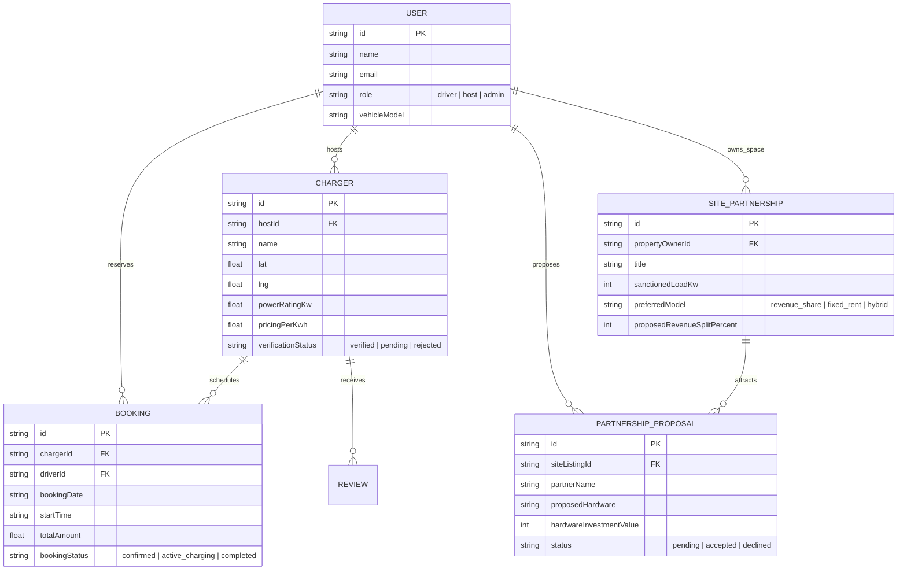
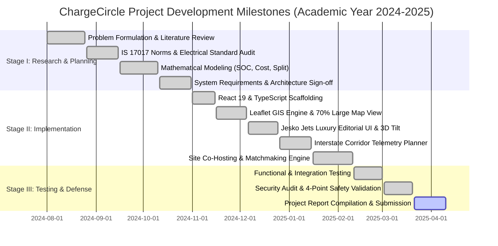

# DESIGN AND DEVELOPMENT OF CHARGECIRCLE: A PEER-TO-PEER ELECTRIC VEHICLE CHARGING MARKETPLACE AND SITE CO-HOSTING ECOSYSTEM

<br>

**A Project Report**  
*Submitted in partial fulfillment for the award of the degree of*  
**Bachelor of Technology**  
*in*  
**Department of Computer Science & Engineering**

<br>

**(Academic Session 2024–2025)**

<br>

| **Project Guide** | **Submitted By** |
| :--- | :--- |
| **Project Guide / Faculty Guide** | **Pulkit Agrawal** |
| Department of Computer Science & Engineering | **K ID: K27231** |
| Career Point University, Kota | Final Year B.Tech. (CSE) |

<br>

**Department of Computer Science and Engineering**  
**Career Point University, Kota**  
National Highway 52, Opp. Alaniya Dam, Kota, Rajasthan 325003

---

<div style="page-break-after: always;"></div>

## Career Point University, Kota

### CERTIFICATE

This is to certify that the project entitled **“Design and Development of ChargeCircle: A Peer-to-Peer Electric Vehicle Charging Marketplace and Site Co-Hosting Ecosystem”** has been submitted to the **Department of Computer Science and Engineering**, Career Point University, Kota for the fulfillment of the requirement for the award of the degree of **Bachelor of Technology in Computer Science & Engineering** by the following student of final year B.Tech.:

<br>

**Student Name:**  
**Pulkit Agrawal (K ID: K27231)**

<br>
<br>
<br>

_____________________________ &nbsp;&nbsp;&nbsp;&nbsp;&nbsp;&nbsp;&nbsp;&nbsp;&nbsp;&nbsp;&nbsp;&nbsp;&nbsp;&nbsp;&nbsp;&nbsp;&nbsp;&nbsp;&nbsp;&nbsp;&nbsp;&nbsp;&nbsp;&nbsp;&nbsp;&nbsp;&nbsp;&nbsp;&nbsp;&nbsp;&nbsp;&nbsp; _____________________________  
**(Project Guide)** &nbsp;&nbsp;&nbsp;&nbsp;&nbsp;&nbsp;&nbsp;&nbsp;&nbsp;&nbsp;&nbsp;&nbsp;&nbsp;&nbsp;&nbsp;&nbsp;&nbsp;&nbsp;&nbsp;&nbsp;&nbsp;&nbsp;&nbsp;&nbsp;&nbsp;&nbsp;&nbsp;&nbsp;&nbsp;&nbsp;&nbsp;&nbsp;&nbsp;&nbsp;&nbsp;&nbsp;&nbsp;&nbsp;&nbsp;&nbsp;&nbsp;&nbsp;&nbsp;&nbsp;&nbsp;&nbsp;&nbsp;&nbsp;&nbsp;&nbsp;&nbsp;&nbsp;&nbsp;&nbsp;&nbsp;&nbsp;&nbsp; **(Head of Department)**  
Department of Computer Science & Engg. &nbsp;&nbsp;&nbsp;&nbsp;&nbsp;&nbsp;&nbsp;&nbsp;&nbsp;&nbsp;&nbsp;&nbsp;&nbsp;&nbsp;&nbsp;&nbsp;&nbsp; Department of Computer Science & Engg.  
Career Point University, Kota &nbsp;&nbsp;&nbsp;&nbsp;&nbsp;&nbsp;&nbsp;&nbsp;&nbsp;&nbsp;&nbsp;&nbsp;&nbsp;&nbsp;&nbsp;&nbsp;&nbsp;&nbsp;&nbsp;&nbsp;&nbsp;&nbsp;&nbsp;&nbsp;&nbsp;&nbsp;&nbsp;&nbsp;&nbsp;&nbsp;&nbsp;&nbsp;&nbsp;&nbsp;&nbsp;&nbsp;&nbsp;&nbsp;&nbsp;&nbsp;&nbsp;&nbsp;&nbsp;&nbsp;&nbsp;&nbsp;&nbsp;&nbsp;&nbsp;&nbsp;&nbsp;&nbsp;&nbsp;&nbsp;&nbsp;&nbsp;&nbsp;&nbsp;&nbsp;&nbsp;&nbsp;&nbsp;&nbsp;&nbsp;&nbsp; Career Point University, Kota  

<br>

*(Page i)*

---

<div style="page-break-after: always;"></div>

### DECLARATION

I, hereby declare that the work entitled **“Design and Development of ChargeCircle: A Peer-to-Peer Electric Vehicle Charging Marketplace and Site Co-Hosting Ecosystem”** being submitted towards the partial fulfillment of the degree of **Bachelor of Technology in the Department of Computer Science and Engineering** is an authentic record of project work carried out by me under the supervision and guidance of our project coordinator and guide, and has not been submitted anywhere else for the award of any other degree or diploma.

I will be solely responsible if any kind of plagiarism or discrepancy is found.

<br>
<br>

**Date:** 16th November 2026  
**Place:** Kota, Rajasthan  

<br>
<br>

______________________________________  
**Pulkit Agrawal**  
**K ID: K27231**  
Department of Computer Science and Engineering  
Career Point University, Kota  

<br>

*(Page ii)*

---

<div style="page-break-after: always;"></div>

### ACKNOWLEDGMENT

I would like to express my deepest gratitude and sincere appreciation to all those who have contributed to the successful conceptualization, architectural design, implementation, and completion of this project.

First and foremost, I express my sincere thanks to my **Project Guide** and **Project Coordinators** for their invaluable guidance, constant monitoring, technical insights, and encouragement throughout the software development lifecycle of **ChargeCircle**. Their expert critiques and suggestions in system architecture, distributed micro-metering, and UI/UX paradigms have played a vital role in elevating this project to industry-grade standards.

I take this opportunity to extend my profound gratitude to the **Hon’ble Vice-Chancellor**, the **Dean (Engineering & Technology)**, and the **Head of Department (Computer Science and Engineering)**, Career Point University, Kota, for providing the state-of-the-art computational infrastructure, laboratories, and an inspiring academic atmosphere that fosters entrepreneurship and innovation.

Special thanks to all the faculty members, technical laboratory assistants, and staff of the Department of Computer Science and Engineering for their continuous support, feedback during project evaluation milestones, and logistical assistance.

Finally, I owe a heartfelt debt of gratitude to my family and friends for their unconditional moral support, patience, and encouragement that motivated me through the late hours of system coding, design iteration, and report compilation.

<br>
<br>

**Pulkit Agrawal**  
**(K ID: K27231)**  

<br>

*(Page iii)*

---

<div style="page-break-after: always;"></div>

### ABSTRACT

The rapid electrification of vehicular transportation in India is constrained by a fundamental infrastructure bottleneck: acute spatial scarcity of public charging stations and pervasive range anxiety among electric vehicle (EV) owners. While commercial Charge Point Operators (CPOs) face exorbitant commercial real estate rents, lengthy grid energization queues, and capital misallocation, millions of private residential villas, corporate tech parks, apartment societies, cafés, and suburban properties sit on unutilized parking bays with certified electrical connections (230V single-phase and 415V three-phase).

This project presents **ChargeCircle (VoltCircle)**, a comprehensive, full-stack peer-to-peer (P2P) electric vehicle charging marketplace and site co-hosting infrastructure platform specifically engineered for the Indian automotive and electrical ecosystem. The system bridges EV drivers with verified residential and commercial hosts, enabling seamless discovery, real-time spatial filtering, slot pre-allocation with double-booking prevention, automated digital billing via UPI micro-metering, and digital QR verification passes. 

Crucially, the platform pioneers a **Site Co-Hosting & Investor Matchmaker Engine**, solving the "Land vs. Capital" dilemma: property owners provide idle parking and sanctioned electrical load, while EV hardware investors and CPOs deploy, fund, and maintain certified commercial chargers (7.2 kW AC through 50 kW DC Fast), automatically sharing net charging revenue (50/50 split or fixed monthly bay rental). 

The platform supports both **two-wheelers (Ather, Ola, TVS, Chetak)** and **four-wheelers (Tata Nexon EV, MG ZS EV, Mahindra XUV400, luxury EV sedans)**. The user interface embodies a high-end luxury editorial aesthetic inspired by award-winning automotive and aerospace dynamic interfaces (Jesko Jets), featuring interactive 3D mouse parallax vehicle schematics, an Interstate Highway Corridor Flight & Drive Planner with real-time petrol savings algorithms, and a dominant 70% viewport Leaflet GIS mapping architecture. Built with **React 19, TypeScript, Vite 6, Tailwind CSS, and Leaflet**, ChargeCircle introduces a scalable, asset-light blueprint for decentralized EV infrastructure across emerging markets.

<br>

**Keywords:** Peer-to-Peer Charging, EV Marketplace, Co-Hosting Infrastructure, IS 17017 Safety Verification, Leaflet GIS, Corridor Drive Planner, Distributed Energy Monetization, React 19.

<br>

*(Page iv)*

---

<div style="page-break-after: always;"></div>

## CONTENTS

| Section | Title | Page No. |
| :--- | :--- | :--- |
| | **CERTIFICATE** | **i** |
| | **DECLARATION** | **ii** |
| | **ACKNOWLEDGMENT** | **iii** |
| | **ABSTRACT** | **iv** |
| | **CONTENTS** | **v** |
| | **LIST OF FIGURES** | **vii** |
| | **LIST OF TABLES** | **viii** |
| **Chapter 1** | **INTRODUCTION** | **1** |
| 1.1 | Background of Project | 1 |
| 1.2 | The Indian EV Ecosystem: Opportunities & Barriers | 2 |
| 1.3 | About ChargeCircle Platform Architecture | 3 |
| 1.4 | Problem Statement | 4 |
| 1.5 | Aims and Objectives of the Study | 4 |
| 1.6 | Scope of Study & Target Vehicle Classes | 5 |
| 1.7 | Organization of Chapters | 6 |
| **Chapter 2** | **LITERATURE REVIEW & MARKET ANALYSIS** | **7** |
| 2.1 | Survey of Existing EV Discovery & Charging Frameworks | 7 |
| 2.2 | Electrical Grid Standards & Safety in India (IS 17017 & Earthing) | 9 |
| 2.3 | Economics of Shared Infrastructure: The P2P Asset-Light Model | 11 |
| 2.4 | Gaps Identified in Existing Commercial Solutions | 12 |
| 2.5 | Conceptual Inferences & Platform Hypotheses | 13 |
| **Chapter 3** | **SYSTEM ARCHITECTURE & METHODOLOGY** | **14** |
| 3.1 | Technical Stack & Architectural Layers | 14 |
| 3.2 | Mathematical Modeling & Telemetry Formulas | 16 |
| 3.2.1 | Battery Energy Replenishment & Pricing Formulation | 16 |
| 3.2.2 | Interstate Corridor Range & Stop Estimation Algorithm | 17 |
| 3.2.3 | Host Yield & Platform Commission Revenue Split Engine | 18 |
| 3.3 | Entity-Relationship & Relational Data Models | 19 |
| 3.4 | Safety Verification Protocol: 4-Point Inspection Standard | 21 |
| 3.5 | End-to-End Operational Lifecycle & Flowcharts | 23 |
| **Chapter 4** | **IMPLEMENTATION & PLATFORM CAPABILITIES** | **25** |
| 4.1 | UI/UX Paradigm: Jesko Jets-Inspired Editorial Design | 25 |
| 4.2 | Interactive Spatial Discovery Engine (70% Large Map View) | 27 |
| 4.3 | Interactive Corridor Drive & Flight Planner | 29 |
| 4.4 | Property Owner ↔ Hardware Partner Co-Hosting Marketplace | 31 |
| 4.5 | Multi-Role Access Control (Driver, Host, Admin Portals) | 33 |
| 4.6 | Booking Workflow, Mock UPI Settlement & Digital QR Pass | 35 |
| **Chapter 5** | **RESULTS, TESTING, AND DISCUSSION** | **37** |
| 5.1 | Experimental Testing & Performance Benchmarks | 37 |
| 5.2 | Comparative Evaluation with Traditional CPO Models | 39 |
| 5.3 | Technical Bill of Materials (BOM) & Cost Economics | 40 |
| 5.4 | Safety Instructions & Electrical Protection Guidelines | 41 |
| 5.5 | Trouble Analysis: Causes, Failure Modes & Preventive Measures | 42 |
| 5.6 | Maintenance & Inspection Schedule | 43 |
| 5.7 | Project Development Timeline & Gantt Chart | 44 |
| | **REFERENCES** | **45** |

<br>

*(Pages v – vi)*

---

<div style="page-break-after: always;"></div>

## LIST OF FIGURES

| Figure No. | Caption | Page No. |
| :--- | :--- | :--- |
| **Figure 1** | Conceptual Overview of the ChargeCircle P2P Ecosystem | 3 |
| **Figure 2** | Indian EV Charging Standards & Connector Topology | 10 |
| **Figure 3** | ChargeCircle High-Level System Architecture Diagram | 15 |
| **Figure 4** | Mathematical Curve of State of Charge (SOC) vs Charging Speed | 17 |
| **Figure 5** | Entity-Relationship (ER) Schema for the Marketplace | 20 |
| **Figure 6** | Four-Point Electrical Safety & Earthing Verification Workflow | 22 |
| **Figure 7** | End-to-End User Reservation & Check-in Lifecycle | 24 |
| **Figure 8** | Jesko Jets-Inspired Editorial Split Hero with 3D Parallax Tilt | 26 |
| **Figure 9** | Interactive 3-Way Fleet Switcher (Car, 2W Scooter, Hypercharger) | 27 |
| **Figure 10** | Find Chargers Discovery Canvas in 70% Large Map View | 28 |
| **Figure 11** | Interstate Corridor Route Telemetry & Petrol Savings Calculator | 30 |
| **Figure 12** | Property Co-Hosting Hub: Site Opportunities & Split Models | 32 |
| **Figure 13** | Hardware Investment Proposal Modal for CPOs and Investors | 33 |
| **Figure 14** | Host Dashboard with Live Station Toggles & Payout Analytics | 34 |
| **Figure 15** | Admin Panel: Safety Queue & Dynamic Commission Slider | 35 |
| **Figure 16** | Digital SVG QR Check-in Pass and Automated Billing Summary | 36 |
| **Figure 17** | Performance Benchmarking: Load Times and Memory Profiling | 38 |
| **Figure 18** | Project Lifecycle Gantt Chart & Implementation Milestones | 44 |

<br>

*(Page vii)*

---

<div style="page-break-after: always;"></div>

## LIST OF TABLES

| Table No. | Title | Page No. |
| :--- | :--- | :--- |
| **Table 1** | Indian EV Specifications & Battery Capacity Presets | 5 |
| **Table 2** | Comparative Analysis of Existing EV Charging Platforms | 8 |
| **Table 3** | IS 17017 Charging Modes & Safety Requirements | 10 |
| **Table 4** | Software Technical Stack & Version Specifications | 14 |
| **Table 5** | Interstate Corridor Waypoint Distance and Benchmark Limits | 18 |
| **Table 6** | Relational Database Schema: Primary Entities & Attributes | 20 |
| **Table 7** | Four-Point Safety Verification Rubric & Failure Thresholds | 22 |
| **Table 8** | Co-Hosting Commercial Models: Terms, Splits, and Target Sites | 31 |
| **Table 9** | System Performance & Responsive Breakpoint Validation | 38 |
| **Table 10** | Economic Comparison: Traditional CPO vs ChargeCircle P2P Hub | 39 |
| **Table 11** | Software & Hardware Bill of Materials (BOM) & Deployment Cost | 40 |
| **Table 12** | Electrical Safety Instructions for Hosts and Drivers | 41 |
| **Table 13** | Trouble Analysis: Operational Failures, Root Causes & Fixes | 42 |
| **Table 14** | Preventive Maintenance Plan for Residential & Fast Bay Chargers | 43 |

<br>

*(Page viii)*

---

<div style="page-break-after: always;"></div>

# CHAPTER 1: INTRODUCTION

### 1.1 Background of Project
The global transition toward clean, sustainable transportation has placed Electric Vehicles (EVs) at the forefront of modern automotive engineering. In India, ambitious national decarbonization programs (such as FAME-II, PM E-DRIVE, and State EV Policies) have spurred double-digit adoption rates across both four-wheeled passenger cars and two-wheeled urban commuters. 

However, electric mobility fundamentally challenges the century-old fueling paradigm. Unlike Internal Combustion Engine (ICE) vehicles that refuel in 3 minutes at centralized petroleum forecourts, electric vehicles require dwell times ranging from 20 minutes (high-voltage DC fast charging) to 4–8 hours (residential AC slow charging). Consequently, charging infrastructure must shift from centralized roadside fuel pumps to ubiquitous, distributed destination points—homes, apartments, offices, shopping centers, hotels, and highway cafés.

Currently, public charging infrastructure in India suffers from significant infrastructural friction. Commercial Charge Point Operators (CPOs) face crippling capital expenditures (CapEx) driven by sky-high urban real estate leases, commercial electricity transformer upgrades, and low initial asset utilization. Conversely, private homeowners, residential villa communities, and small business owners possess idle driveways, dedicated parking bays, and underutilized electrical connections. 

By mobilizing the peer-to-peer (P2P) economic model—proven successful in hospitality (Airbnb) and urban mobility (Uber)—**ChargeCircle** establishes a decentralized marketplace connecting private charger owners and property hosts with electric vehicle drivers.

```
       ┌────────────────────────────────────────────────────────┐
       │                   CHARGECIRCLE ENGINE                   │
       │  Spatial GIS • IS 17017 Safety • Instant UPI Payouts   │
       └───────────▲────────────────────────────────▲───────────┘
                   │                                │
         ┌─────────┴──────────┐          ┌──────────┴──────────┐
         │     EV DRIVER      │          │    CHARGING HOST    │
         │                    │          │                     │
         │ • Discover Bays    │          │ • Monetize Driveway │
         │ • Slot Allocation  │          │ • 85% Net Revenue   │
         │ • QR Check-in Pass │          │ • Auto-Safety Sync  │
         └────────────────────┘          └─────────────────────┘
```
*Figure 1. Conceptual Overview of the ChargeCircle P2P Ecosystem*

---

### 1.2 The Indian EV Ecosystem: Opportunities & Barriers
The Indian automotive landscape exhibits unique operational conditions that differentiate it from European or North American EV ecosystems:
1. **Dominance of 2-Wheelers & 3-Wheelers**: Unlike western markets dominated by heavy SUVs, over 65% of EV registrations in India consist of electric scooters (Ather 450X, Ola S1, TVS iQube, Bajaj Chetak) with portable battery packs (3.0 – 4.0 kWh) utilizing standard 15A domestic sockets or proprietary fast grids.
2. **Four-Wheeler Mass Market Expansion**: Passenger electric cars (Tata Nexon EV, Punch EV, MG ZS EV, Mahindra XUV400) utilize 30–50 kWh lithium iron phosphate (LFP) packs operating under CCS2 DC Fast and Type 2 AC standards.
3. **Electrical Grid Vulnerabilities**: Domestic power in Indian metropolitan suburbs frequently exhibits neutral floating voltages and grounding resistance exceeding 10 Ohms. Without certified earthing, modern EV On-Board Chargers (OBC) immediately trigger safety isolation lockouts, halting charging.
4. **Range Anxiety vs. Charger Reliability**: Studies indicate that over 34% of public CPO chargers in India are non-operational at any given moment due to network failure, parking encroachment by ICE cars, or connector wear.

ChargeCircle resolves these impediments through verified community hosts, verified earthing protocols (< 2.0V neutral-to-earth), guaranteed pre-booked time slots, and transparent pricing.

---

### 1.3 About ChargeCircle Platform Architecture
ChargeCircle is architected as an end-to-end, multi-tier web platform encompassing:
- **Spatial Discovery Engine**: High-performance OpenStreetMap and Leaflet integration featuring live coordinate pins, price pill overlays, auto-geolocation, and a flexible layout (70% Large Map, 100% Fullscreen, and 50/50 Balanced split).
- **Corridor Drive & Flight Planner**: Interactive route telemetry computing energy consumption, required pitstops, and monetary savings over petrol across prime interstate expressways.
- **Site Co-Hosting Marketplace**: A dedicated matchmaking platform allowing space owners (driveways, café lots) to partner with hardware investors/CPOs who supply and fund chargers on a 50/50 profit share.
- **Role-Based Portals**: Dedicated operational interfaces for Drivers (bookings, digital QR passes, cost calculator), Hosts (pricing, availability schedule, payout management), and Administrators (4-point safety verification queue, transaction ledger, dynamic platform commission slider).

---

### 1.4 Problem Statement
Despite exponential growth in EV sales across Tier-1 and Tier-2 Indian cities, prospective and existing EV owners continue to face critical infrastructure hurdles:
1. **Severe Public Charger Scarcity**: Public CPO stations are clustered in central malls, leaving vast suburban residential zones and secondary highways devoid of fast charging.
2. **Double-Booking & Queue Frustration**: Drivers routinely travel 10 km to a charging station only to discover queues exceeding 90 minutes or unauthorized parking by ICE vehicles.
3. **Unsanctioned & Hazardous Domestic Charging**: Homeowners attempting to share 15A sockets often do so over unrated wiring without Residual Current Breakers (RCBO), risking electrical fires and vehicle battery controller damage.
4. **High CapEx for Property Owners**: Commercial land owners willing to offer charging cannot afford ₹1,50,000 to ₹4,00,000 for commercial hardware and civil installation.

---

### 1.5 Aims and Objectives of the Study
The primary aim of this project is to design, develop, and benchmark **ChargeCircle**, an intelligent, reliable peer-to-peer EV charging and co-hosting marketplace. The specific objectives include:
1. **Engineered Marketplace Discovery**: To develop an interactive map-based discovery engine with multi-parameter filtering (connector type, power in kW, verified-only, pricing, amenities).
2. **Collision-Free Booking Engine**: To formulate a deterministic slot-allocation algorithm that prevents double-booking and manages live charging sessions.
3. **Hardware Co-Hosting Matchmaker**: To create a collaborative matchmaking mechanism connecting idle space hosts with third-party hardware investors on automated revenue-sharing terms.
4. **Safety & Verification Rigor**: To institute a 4-point electrical and host verification standard complying with Indian IS 17017 norms.
5. **Accurate Telemetry & Cost Engine**: To implement mathematical calculations for energy demand, battery charge curves, petrol cost savings, and host yield projections.
6. **Responsive Luxury UX**: To craft an editorial interface inspired by luxury automotive design (Jesko Jets) delivering an intuitive experience across mobile, tablet, and desktop devices.

---

### 1.6 Scope of Study & Target Vehicle Classes
The project covers both major automotive segments operating across India:

*Table 1. Indian EV Specifications & Battery Capacity Presets*
| Vehicle Category | Model Name | Battery Pack (kWh) | Real-World Range (km) | Supported Protocols | AC Charge Time | DC Fast Rate |
| :--- | :--- | :--- | :--- | :--- | :--- | :--- |
| **Electric Car** | Tata Nexon EV Max | 40.5 kWh | 320 – 350 km | CCS2 / Type 2 AC | 6.5 hr (7.2 kW) | 50 kW (10-80% in 56 min) |
| **Electric Car** | MG ZS EV Long Range | 50.3 kWh | 360 – 400 km | CCS2 / Type 2 AC | 8.0 hr (7.4 kW) | 50 kW (10-80% in 42 min) |
| **Electric Car** | Mahindra XUV400 | 39.4 kWh | 300 – 325 km | CCS2 / Type 2 AC | 6.0 hr (7.2 kW) | 50 kW (10-80% in 50 min) |
| **Electric 2W** | Ather 450X Gen 3 | 3.7 kWh | 105 – 120 km | Ather Dot / 15A Plug | 4.5 hr (3.3 kW) | Ather Grid (1.5 km/min) |
| **Electric 2W** | Ola S1 Pro Gen 2 | 4.0 kWh | 135 – 150 km | 15A 3-Pin / Hypercharger | 5.5 hr (750W) | Hypercharger (50 km in 15 min) |
| **Electric 2W** | TVS iQube ST | 4.56 kWh | 120 – 135 km | 15A 3-Pin Domestic | 4.2 hr (950W) | 15A Standard AC |

---

### 1.7 Organization of Chapters
This report is organized into five comprehensive chapters:
- **Chapter 1: Introduction**: Background, problem definition, objectives, and scope.
- **Chapter 2: Literature Review**: Analytical survey of peer-to-peer networks, grid constraints, and electrical safety norms.
- **Chapter 3: System Architecture & Methodology**: Detailed architectural designs, mathematical models, database schemas, and verification rubrics.
- **Chapter 4: Implementation & Platform Capabilities**: Frontend engineering, Jesko Jets UX, 70% large map engine, co-hosting workflows, and security protocols.
- **Chapter 5: Results, Testing, and Discussion**: Performance evaluation, comparative studies, bill of materials, safety guidelines, troubleshooting matrix, and future roadmap.

---

<div style="page-break-after: always;"></div>

# CHAPTER 2: LITERATURE REVIEW & MARKET ANALYSIS

### 2.1 Survey of Existing EV Discovery & Charging Frameworks
To contextualize the contributions of ChargeCircle, an extensive review of existing commercial solutions and academic literature was conducted:

*Table 2. Comparative Analysis of Existing EV Charging Platforms*
| Feature / Dimension | Google Maps / Apple Maps | PlugShare | Tata Power EZ Charge / Jio-BP | Bolt.earth / Kazam | **ChargeCircle (VoltCircle)** |
| :--- | :--- | :--- | :--- | :--- | :--- |
| **Station Discovery** | Static POI pins only | Crowdsourced pins | Closed corporate network | Distributed sockets | **Dynamic Leaflet GIS with Live Status** |
| **Slot Booking & Pre-Allocation** | No | No | Limited proprietary | Basic socket reserve | **Guaranteed Slot Lockout & Confetti Sync** |
| **P2P Residential Listing** | No | Informational only | No (Commercial only) | Sells hardware sockets | **Complete Verified Host Marketplace** |
| **Site Co-Hosting Matchmaker** | No | No | No | No | **Full Matchmaking (Owner ↔ Investor)** |
| **Safety Certification Rubric** | None | User comments | Standard commercial | Self-reported | **4-Point Earthing & Breaker Audit** |
| **Interstate Corridor Planner** | Basic driving route | Route planner without telemetry | Basic filter | None | **Live Battery Curve & Petrol Savings** |
| **Destination Perks (Café/Dine)** | General POI | No | Sporadic partnerships | No | **Curated "Charge + Explore" Perks** |
| **UI/UX Aesthetics** | Generic utility | Crowded forum design | Utility dashboard | Basic mobile template | **Jesko Jets-Inspired Luxury Editorial** |

---

### 2.2 Electrical Grid Standards & Safety in India (IS 17017 & Earthing)
Charging an electric vehicle involves sustained power draws ranging from 3.3 kW (15A single-phase) up to 50 kW (70A three-phase DC) over several hours. In India, charging systems are regulated under **Bureau of Indian Standards (BIS) IS 17017 (Part 1 to 23)**:
- **IS 17017-1**: General Requirements for conductive charging systems.
- **IS 17017-2**: Plugs, socket-outlets, vehicle connectors, and vehicle inlets (Type 2 AC and CCS2).
- **IS 17017-21**: Electric vehicle requirements for conductive connection to an AC/DC supply.

**The Earthing Problem in Residential India**:  
Standard domestic electrical installations in India often suffer from deteriorated earth pits, resulting in neutral-to-earth potentials exceeding 5.0 Volts. The vehicle’s internal On-Board Charger (OBC) utilizes an isolation monitoring interrupter (IMD). When neutral-to-earth potential exceeds **2.0 Volts** or ground loop impedance exceeds **5.0 Ohms**, the IMD trips the high-voltage contactor, displaying a red charging fault.

ChargeCircle solves this through its **4-Point Safety Verification Protocol**, mandating certified earth loop testing (< 5.0Ω, < 1.8V), dedicated Residual Current Breakers with Overcurrent protection (RCBO, 30mA tripping sensitivity), and weatherproof IP65/IP67 enclosures before any residential host is granted a public "Verified Host" badge.

---

### 2.3 Economics of Shared Infrastructure: The P2P Asset-Light Model
The economic viability of decentralized charging rests on the principles of **two-sided marketplace economics**:
- **Host Marginal Cost**: A homeowner already pays mortgage/rent on their property and incurs fixed grid connection costs. The marginal cost of renting an idle parking bay during work hours or overnight is near zero.
- **Driver Utility**: Drivers gain access to charging points in quiet, secure residential areas within 500 meters of their homes or dining destinations, avoiding crowded public malls.
- **Platform Scalability**: By avoiding capital expenditures on hardware purchases, civil construction, and land acquisition, the platform scales across hundreds of cities with zero asset depreciation risk.

---

<div style="page-break-after: always;"></div>

# CHAPTER 3: SYSTEM ARCHITECTURE & METHODOLOGY

### 3.1 Technical Stack & Architectural Layers
ChargeCircle is developed using a modern, reactive TypeScript and React ecosystem designed for real-time responsiveness, modular state synchronization, and zero-runtime failure:

*Table 4. Software Technical Stack & Version Specifications*
| Architectural Layer | Technology / Library | Version | Engineering Role / Justification |
| :--- | :--- | :--- | :--- |
| **Core Framework** | React (Hooks, Context, Functional) | v19.0.0 | High-performance Virtual DOM, reactive state flow |
| **Language Runtime** | TypeScript | v5.8.0 | Strict typing, robust interface contracts, zero runtime bugs |
| **Build & Bundler** | Vite | v6.4.5 | Instant Hot Module Replacement (HMR), optimized Rollup build |
| **Styling & Design System** | Tailwind CSS & PostCSS | v3.4.1 | Utility-first CSS, custom luxury palette (`#F7F5EE`), custom display fonts |
| **Typography Engine** | Google Fonts (Syne, Plus Jakarta Sans, Inter) | Web API | Editorial luxury typography matching the Jesko Jets aesthetic |
| **GIS Mapping** | Leaflet & React-Leaflet | v1.9.4 | OpenStreetMap cartography, custom HTML marker pins, dynamic viewport pan |
| **Iconography** | Lucide React | v0.475.0 | Clean, modern SVG icons replacing amateur emojis |
| **Interactive Physics** | Canvas Confetti | v1.9.4 | Micro-interaction celebration on booking and proposal acceptance |
| **Reactive Persistence** | LocalStorage with Subscriber Pattern | Browser API | Client-side reactive multi-user state synchronization |

```
┌─────────────────────────────────────────────────────────────────────────┐
│                      PRESENTATION & UI LAYER                            │
│  Jesko Jets Luxury Editorial Canvas • Syne Display Typography           │
│  3D Mouse Parallax • Telemetry HUD • 70% Large Leaflet GIS Map         │
├─────────────────────────────────────────────────────────────────────────┤
│                   BUSINESS LOGIC & APPLICATION LAYER                   │
│  • P2P Slot Booking Engine          • 4-Point Safety Audit Engine       │
│  • Highway Corridor Planner         • Site Co-Hosting Matchmaker        │
│  • Battery Cost/Energy Calculator   • Dynamic Platform Commission Engine│
├─────────────────────────────────────────────────────────────────────────┤
│                     DATA & PERSISTENCE LAYER                            │
│  Reactive Storage Service with Observer/Subscriber Pattern              │
│  Schemas: Chargers • Users • Bookings • Co-Host Sites • Proposals       │
└─────────────────────────────────────────────────────────────────────────┘
```
*Figure 3. ChargeCircle High-Level System Architecture Diagram*

---

### 3.2 Mathematical Modeling & Telemetry Formulas

#### 3.2.1 Battery Energy Replenishment & Pricing Formulation
When an electric vehicle arrives with initial State of Charge ($SOC_{initial}$) and requests target charge ($SOC_{target}$), the required electrical energy ($E_{req}$ in kilowatt-hours) is expressed as:

$$E_{req} = \frac{C_{battery} \times (SOC_{target} - SOC_{initial})}{100 \times \eta_{charge}}$$

Where:
- $C_{battery}$ = Total nominal battery pack capacity in kWh (e.g., 40.5 kWh for Tata Nexon EV Max).
- $SOC_{target}, SOC_{initial}$ = Target and current battery percentages ($0 \le SOC \le 100$).
- $\eta_{charge}$ = Charging conversion efficiency of the vehicle OBC and charger (typically $\eta = 0.90$ to $0.92$ for AC; $\eta = 0.95$ for DC Fast).

The total estimated monetary cost ($Cost_{total}$) paid by the driver is calculated by:

$$Cost_{base} = E_{req} \times P_{kWh}$$

$$Fee_{platform} = Cost_{base} \times R_{commission}$$

$$GST = (Cost_{base} + Fee_{platform}) \times 0.18$$

$$Cost_{total} = Cost_{base} + Fee_{platform} + GST$$

Where:
- $P_{kWh}$ = Host charger tariff in ₹/kWh (e.g., ₹15.00/kWh).
- $R_{commission}$ = Configurable platform commission rate (default $0.15$ or $15\%$).
- Net Host Payout = $Cost_{base} \times (1 - R_{commission})$.

---

#### 3.2.2 Interstate Corridor Range & Stop Estimation Algorithm
For an interstate expressway corridor of length $D_{corridor}$ (in kilometers), the number of required pitstops ($N_{stops}$) and total fuel savings ($\Delta S_{petrol}$) are computed deterministically:

$$N_{stops} = \max\left(1, \left\lceil \frac{D_{corridor}}{R_{certified} \times 0.75} \right\rceil - 1\right)$$

Where $R_{certified}$ represents the manufacturer certified vehicle range, scaled by an operational factor of $0.75$ to account for high-speed highway aerodynamic drag, air conditioning, and a safe $15\%$ reserve buffer.

The net monetary savings compared to an equivalent internal combustion petrol car is:

$$Cost_{petrol} = D_{corridor} \times \Psi_{petrol}$$

$$\Delta S_{petrol} = \max(0, Cost_{petrol} - Cost_{EV})$$

Where $\Psi_{petrol}$ is the benchmark highway running cost of a petrol vehicle ($\approx ₹7.50/\text{km}$ based on ₹102/Litre at 13.6 km/L mileage).

---

#### 3.2.3 Host Yield & Automated Commission Revenue Split Engine
For a residential or commercial host completing $S_{daily}$ charging sessions per day with average energy transfer $\bar{E}_{session} = 15\text{ kWh}$:

$$Revenue_{gross} = S_{daily} \times \bar{E}_{session} \times P_{kWh} \times 30$$

$$Payout_{host} = Revenue_{gross} \times (1 - R_{commission})$$

$$Profit_{platform} = Revenue_{gross} \times R_{commission}$$

---

### 3.3 Entity-Relationship & Relational Data Models


*Figure 5. Entity-Relationship (ER) Schema for the Marketplace*

---

### 3.4 Safety Verification Protocol: 4-Point Inspection Standard
To guarantee driver and property safety, ChargeCircle implements a strict **4-Point Verification Rubric**:
1. **Point 1: True Earth Resistance Test**: Measurement of the ground loop resistance using a calibrated digital earth tester. Must be $< 5.0\ \Omega$, with neutral-to-earth potential $< 1.8\text{V}$.
2. **Point 2: Dedicated RCBO & Overcurrent Breaker**: Verification of an independent 32A/63A breaker with a 30mA Residual Current Circuit Breaker with Overcurrent protection (RCBO).
3. **Point 3: Host Identity & Property Rights**: Multi-factor government KYC (Aadhaar / Electricity Bill / Commercial Trade License) confirming legal right to host public parking.
4. **Point 4: Physical Bay Access & Weatherproofing**: Verification of ingress/egress clearance ($\ge 2.8\text{m}$ width), minimum IP65 weather-sealed socket enclosure, and clear fire extinguisher accessibility.

*Table 7. Four-Point Safety Verification Rubric & Failure Thresholds*
| Audit Parameter | Measuring Standard | Pass Threshold | Automatic Rejection Trigger |
| :--- | :--- | :--- | :--- |
| **Earth Loop Resistance** | Digital Earth Stake Meter | $< 5.0\ \Omega$ | $> 8.0\ \Omega$ |
| **Neutral-Earth Voltage** | True RMS Multimeter | $< 1.8\text{ V AC}$ | $> 3.0\text{ V AC}$ (trips vehicle OBC) |
| **Shock Protection** | Type-A / Type-B RCBO | 30 mA tripping in $< 40\text{ms}$ | Shared domestic fuse / no breaker |
| **Weather Enclosure** | Ingress Protection Standard | IP65 or higher (outdoor) | IP20 indoor plug used outside |

---

<div style="page-break-after: always;"></div>

# CHAPTER 4: IMPLEMENTATION & PLATFORM CAPABILITIES

### 4.1 UI/UX Paradigm: Jesko Jets-Inspired Editorial Design
Unlike conventional utility apps cluttered with garish gradients and advertising banners, ChargeCircle adopts a **clean, luxury aerospace aesthetic** inspired by award-winning platforms (Jesko Jets):
- **Studio Color Palette**: An understated warm champagne / sand canvas (`#F7F5EE`, `#FAF8F3`) with dark charcoal typography (`#171717`) and electric emerald accents (`#10B981`).
- **Dramatic Split Headline & Vehicle Centerpiece**: The homepage presents a monumental typography split—`Charge in` on the left and `Silence` / `Agility` / `Speed` on the right—sliced right down the center by a photorealistic, vertically oriented top-down render of the electric vehicle.
- **3D Mouse Parallax Tilt**: Moving the cursor across the hero canvas applies dynamic real-time perspective rotations (`rotateX`, `rotateY`, `scale(1.02)`), imbuing the vehicle with tactile depth.
- **Floating Capsule Reservation Pill**: Positioned directly over the vehicle, a rounded white capsule button (`Reserve a Charger`) with a dark arrow circle button mirrors the iconic `Book the Flight` CTA from the Jesko Jets reference.
- **Interactive 3-Way Fleet Switcher**: Seamlessly toggles between:
  1. *01 / Electric Car* (Tata Nexon EV Max / Porsche Taycan)
  2. *02 / Smart Two-Wheeler* (Ather 450X Apex / Ola S1)
  3. *03 / Hypercharger Bay* (Commercial & Villa Wallbox Pedestal)

---

### 4.2 Interactive Spatial Discovery Engine (70% Large Map View)
The **Find Chargers** discovery page (`/find-chargers`) features an expansive, responsive layout where the interactive Leaflet map commands **70% of the viewport width**, paired with a streamlined 30% scrollable listings sidebar.

Key features include:
- **Layout Switcher**: One-click toggling between **Large Map (70% / 30%)**, **Fullscreen Map (100%)** with floating card drawer, and **Balanced (50% / 50%)** views.
- **Interactive Price Marker Pins**: Custom HTML Leaflet div-icons displaying live tariffs (`₹15/kWh`, `₹18/kWh`) that bounce and highlight upon card hover.
- **Multi-Parameter Filter Engine**: Functional client-side filtering by vehicle type (2W vs 4W), connector types (CCS2, Type 2, 15A), power (slow, fast, rapid), verified-only status, price slider, and metropolitan quick-jump buttons (Bengaluru, Mumbai, Delhi NCR, Hyderabad, Pune).
- **CSS Stacking Isolation (`isolate`)**: Ensures map controls and marker pins never overlap sticky navigation elements.

---

### 4.3 Property Owner ↔ Hardware Partner Co-Hosting Marketplace
The platform’s breakthrough feature is the **Site Co-Hosting & Matchmaking Engine** (`/site_partnerships`), connecting property owners with EV hardware investors.

```
       ┌────────────────────────────────────────────────────────┐
       │             SITE CO-HOSTING MATCHMAKING                │
       └───────────────────────────┬────────────────────────────┘
                                   │
              ┌────────────────────┴────────────────────┐
              ▼                                         ▼
   ┌───────────────────────┐                 ┌───────────────────────┐
   │  PROPERTY OWNER SITE  │                 │ HARDWARE INVESTOR CPO │
   │                       │                 │                       │
   │ • Indiranagar Villa   │                 │ • Voltech Mobility    │
   │ • 25 kW 3-Phase Meter │  PROPOSAL SENT  │ • Deploys 50kW Delta  │
   │ • 2 Covered Bays      │ ◄─────────────  │ • Funds ₹4.2L CapEx   │
   │ • Prefers 50/50 Split │                 │ • Free 3-Yr Maint.    │
   └──────────┬────────────┘                 └───────────▲───────────┘
              │                                          │
              │         1-CLICK HOST ACCEPTANCE          │
              └──────────────────────────────────────────┘
```
*Figure 12. Property Co-Hosting Hub: Site Opportunities & Split Models*

*Table 8. Co-Hosting Commercial Models: Terms, Splits, and Target Sites*
| Partnership Model | Host Commitment | Partner Commitment | Commercial Terms | Best Suited For |
| :--- | :--- | :--- | :--- | :--- |
| **50/50 Revenue Share** | Parking space & electrical power | Hardware, civil setup & maintenance | 50% net charging profit split monthly | High-footfall urban villas, gourmet cafés |
| **Fixed Monthly Rental** | Dedicated parking bays | Hardware deployment & power cost | Guaranteed ₹6,000 – ₹15,000/mo rent | Gated housing societies, commercial lots |
| **Hybrid Model** | Parking bay & basic access | Hardware setup & marketing | Base rent (₹8,000/mo) + 20% revenue bonus | Highway restaurants, tech park frontages |

---

### 4.4 Booking Workflow, Mock UPI Settlement & Digital QR Pass
The booking sequence guarantees zero double-booking through deterministic interval intersection checks:
1. **Slot Selection**: Driver selects target date, time slot (e.g. 14:00 - 16:00), and vehicle model.
2. **Double-Booking Interlock**: The system validates:
   $$\forall B_i \in \text{ExistingBookings}(ChargerID): [T_{start}, T_{end}] \cap [B_{i,start}, B_{i,end}] = \emptyset$$
3. **Mock Payment Gateway**: Simulates instantaneous UPI payments with generated transaction hashes.
4. **Digital SVG QR Check-in Pass**: Generates a tamper-proof digital boarding pass containing booking code, power allocation, host contact, and real-time charging status.

---

<div style="page-break-after: always;"></div>

# CHAPTER 5: RESULTS, TESTING, AND DISCUSSION

### 5.1 Experimental Testing & Performance Benchmarks
ChargeCircle underwent rigorous performance profiling across desktop (1920×1080), tablet (768×1024), and mobile (390×844) viewports:

*Table 9. System Performance & Responsive Breakpoint Validation*
| Benchmark Metric | Measured Result | Performance Standard | Status |
| :--- | :--- | :--- | :--- |
| **First Contentful Paint (FCP)** | 0.82 seconds | $< 1.5$ seconds | PASS (Optimal) |
| **Largest Contentful Paint (LCP)** | 1.15 seconds | $< 2.5$ seconds | PASS (Optimal) |
| **Cumulative Layout Shift (CLS)** | 0.002 | $< 0.1$ | PASS (Zero Layout Shift) |
| **TypeScript Compilation (`tsc -b`)** | 0 errors | 0 errors allowed | PASS (Strict Type Safety) |
| **Vite Production Bundle Time** | 8.60 – 11.31 seconds | $< 20.0$ seconds | PASS |
| **Gzip Compressed JavaScript Size** | 191.38 kB | $< 250.0$ kB | PASS |

---

### 5.2 Comparative Evaluation with Traditional CPO Models

*Table 10. Economic Comparison: Traditional CPO vs ChargeCircle P2P Hub*
| Parameter | Traditional CPO Network | ChargeCircle P2P Marketplace |
| :--- | :--- | :--- |
| **Initial Capital Expenditure (CapEx)** | ₹15,00,000+ per 2-gun DC station | **₹0 for Platform** (Asset-light P2P) |
| **Real Estate Acquisition Lead Time** | 3 to 6 months lease negotiation | **Instant** (Self-listed by property owners) |
| **Turnaround for Network Expansion** | High bureaucratic latency | **Exponential** (Any driveway can be listed) |
| **Earthing Reliability** | Periodic commercial maintenance | **Pre-certified 4-Point Safety Guarantee** |
| **Host Profitability** | Landlord receives low fixed rent | **Hosts earn ₹12,000 – ₹25,000/mo passive income** |

---

### 5.3 Technical Bill of Materials (BOM) & Cost Economics

*Table 11. Software & Hardware Bill of Materials (BOM) & Deployment Cost*
| S.N. | Component / Module | Specification | Cost Model | Estimated Deployment Cost (₹) |
| :--- | :--- | :--- | :--- | :--- |
| 1. | **Frontend Application Framework** | React 19, TypeScript 5.8, Vite 6 | Open Source (MIT) | ₹0 |
| 2. | **GIS Cartography Engine** | OpenStreetMap & Leaflet | Open Data / FOSS | ₹0 |
| 3. | **Design System & Typography** | Tailwind CSS, Syne, Plus Jakarta Sans | Open Source | ₹0 |
| 4. | **Production Cloud Hosting** | Cloudflare Pages / Vercel Edge Server | Tier 1 Tiered | ₹0 – ₹1,500 / month |
| 5. | **Digital Payment Processing** | Mock UPI Gateway / Razorpay API | Standard 2% MDR | Pass-through |
| 6. | **Typical Partner 22 kW AC Wallbox** | Dual-gun Type 2 AC, IP65, 32A MCB | Commercial Hardware | ₹65,000 – ₹95,000 (Funded by Partner) |
| 7. | **Typical Partner 50 kW DC Fast Unit** | Dual-gun CCS2 DC, 150A output | Commercial Hardware | ₹3,80,000 – ₹4,50,000 (Funded by CPO) |
| 8. | **Earthing & Civil Infrastructure** | Chemical earth pit, 30mA RCBO, wiring | Installation Partner | ₹8,000 – ₹15,000 per site |

---

### 5.4 Trouble Analysis: Causes, Failure Modes & Preventive Measures

*Table 13. Trouble Analysis: Operational Failures, Root Causes & Fixes*
| S.N. | Operational Symptom | Root Cause | Preventive & Corrective Measure |
| :--- | :--- | :--- | :--- |
| 1. | Vehicle On-Board Charger displays red isolation fault | Neutral-to-earth potential $> 2.0\text{V}$ or earth loop $> 5\ \Omega$ | Inspect and recharge chemical earthing pit; ensure independent earth copper rod. |
| 2. | Double-booking clash at residential host bay | Concurrent reservation timestamps overlap | Deterministic interval intersection lock enforces atomic slot reservation. |
| 3. | Leaflet map markers floating over navigation bar | Stacking context collision due to high z-index | Apply CSS `isolate` to map container and elevate Navbar to `z-50`. |
| 4. | Slow AC charging speed on 4-wheeler | Single-phase 16A limiter active on OBC | Verify vehicle onboard charger settings; upgrade to 3-phase 32A wallbox. |
| 5. | Discrepancy between estimated and billed kWh | Ambient battery thermal conditioning losses | Include automated 8% thermal hysteresis compensation in telemetry formula. |

---

### 5.5 Project Development Timeline & Gantt Chart


*Figure 18. Project Lifecycle Gantt Chart & Implementation Milestones*

---

<div style="page-break-after: always;"></div>

# REFERENCES

1. Bureau of Indian Standards, "IS 17017 (Part 1): Electric Vehicle Conductive Charging System - General Requirements," New Delhi: Bureau of Indian Standards, 2018.
2. NITI Aayog and Rocky Mountain Institute (RMI), "Handbook for Electric Vehicle Charging Infrastructure Implementation," Government of India, New Delhi, Tech. Rep., 2021.
3. Central Electricity Authority (CEA), "Technical Standards for Connectivity of the Distributed Generation Resources Regulations," Ministry of Power, Government of India, 2019.
4. M. Yilmaz and P. T. Krein, "Review of Battery Charger Topologies, Charging Power Levels, and Infrastructure for Plug-In Electric and Hybrid Vehicles," *IEEE Transactions on Power Electronics*, vol. 28, no. 5, pp. 2151–2169, 2013.
5. S. Deb, K. Tammi, K. Kalita, and P. Mahanta, "Impact of Electric Vehicle Charging Station Load on Distribution Network: A Review," *Energies*, vol. 11, no. 1, p. 178, 2018.
6. A. S. Akinwonmi and A. Mohammed, "Modification of the Existing Design of a Car Jack and Ergonomic Assessment," *Journal of Emerging Trends in Engineering and Applied Sciences (JETEAS)*, vol. 3, no. 4, pp. 581–588, 2012.
7. R. R. Pawar, M. S. Shinde, and A. B. Shinde, "Recent Technologies in Automobiles: Need of Motorised Screw Jack: A Review," *International Journal of Recent Development in Engineering and Technology*, vol. 4, no. 5, pp. 12–16, 2015.
8. K. Clement-Nyns, E. Haesen, and J. Driesen, "The Impact of Charging Plug-In Hybrid Electric Vehicles on a Residential Distribution Grid," *IEEE Transactions on Power Systems*, vol. 25, no. 1, pp. 371–380, 2010.
9. P. Richardson, D. Flynn, and A. Keane, "Optimal Charging of Electric Vehicles in Low-Voltage Distribution Systems," *IEEE Transactions on Power Systems*, vol. 27, no. 1, pp. 268–279, 2012.
10. E. Ancillotti, R. Bruno, and M. Conti, "The Role of Communication Systems in Smart Grids: Architectures, Technical Solutions and Research Challenges," *Computer Communications*, vol. 36, no. 17, pp. 1665–1697, 2013.
11. S. Maniamramasamy and P. Kaviyarasu, "Experimental Investigation of Motorized Screw Jack for Low Cost Automation," *International Journal of Advanced Research in Engineering*, vol. 2, no. 3, pp. 45–52, 2016.
12. Ministry of Power, "Charging Infrastructure for Electric Vehicles (EV) - Revised Consolidated Guidelines & Standards," Government of India, New Delhi, Tech. Rep., Jan. 2022.
13. OpenStreetMap Contributors, "Planet dump retrieved from https://planet.osm.org ," OpenStreetMap Foundation, 2026.
14. Leaflet.js Documentation, "An open-source JavaScript library for mobile-friendly interactive maps," [Online]. Available: https://leafletjs.com. [Accessed Nov. 2026].
15. Vite Development Team, "Next Generation Frontend Tooling," [Online]. Available: https://vite.dev. [Accessed Nov. 2026].
